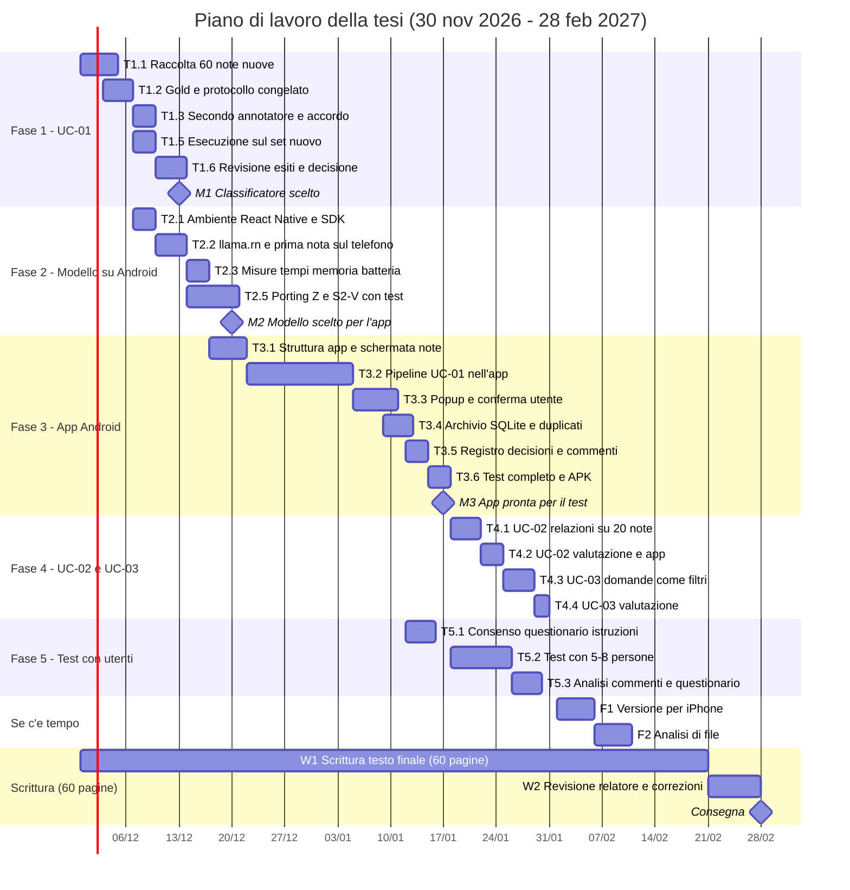

# Piano di lavoro

Questo file descrive dove voglio arrivare con la tesi e i passaggi che ho in programma da qui alla consegna. Lo aggiorno man mano che le fasi si chiudono.

## Dove voglio arrivare

L'obiettivo finale è un'**applicazione mobile**, per ora **per Android** (e in seguito, se c'è tempo, anche per iPhone), in cui scrivo una nota in linguaggio naturale e un modello linguistico piccolo, eseguito sul telefono, la interpreta e, quando ha senso, propone di trasformarla in un'attività o in un appuntamento. Il modello non agisce mai da solo: interpreta il testo, una parte deterministica verifica le condizioni e decide se proporre, chiedere un chiarimento o non intervenire, e l'ultima parola spetta sempre all'utente.

I casi d'uso previsti sono tre:

| Caso d'uso | Cosa fa | Stato attuale |
|---|---|---|
| **UC-01** — Note, attività ed eventi | Estrae TASK / EVENT / FACT da una nota, ne classifica l'intenzione (COMMITTED, TENTATIVE, HYPOTHETICAL, COMPLETED, NEGATED, INFORMATIONAL) e decide tra PROPOSE, CLARIFY, NO_ACTION | Pipeline X0 → C2 → Z → S2-V sperimentata su Mac (esperimenti 01–09) e prototipo funzionante |
| **UC-02** — Relazioni tra informazioni | Riconosce collegamenti tra attività, persone e progetti (appartenenza, destinatario, «prima di») | Solo progettato |
| **UC-03** — Domande sui dati personali | Risponde a domande sull'archivio («Quali attività ho ancora aperte per il progetto Loto?») usando solo i dati memorizzati | Solo progettato |

I vincoli principali sono l'elaborazione locale (privacy), tempi di risposta e consumo di memoria compatibili con uno smartphone, la tracciabilità delle decisioni e la separazione tra dati di sviluppo e dati di valutazione.

Ho tempo fino a **fine febbraio 2027**, cioè circa tre mesi. La priorità è portare UC-01 a un livello valutato in modo onesto e farlo funzionare in un'app Android reale, con un piccolo test con utenti. UC-02 e UC-03 li affronto in forma ridotta, come prova di fattibilità, così da poter discutere nella tesi cosa funziona e cosa no, senza pretendere di completarli.

## Le fasi

Legenda: **[essenziale]** = deve esserci nella tesi; **[se c'è tempo]** = lo faccio solo se le fasi essenziali sono in linea con il calendario.

### Fase 1 — Chiudere UC-01 dal lato del modello [essenziale]
*30 novembre – 13 dicembre*

Finora ho lavorato su note sintetiche che conoscevo già. Prima di tutto mi serve una valutazione su note nuove.

1. **Preparare un set di valutazione nuovo**: circa 60 note scritte da 3–4 persone diverse da me, con poche istruzioni («scrivi appunti come li scriveresti per te»). Le note non verranno usate per modificare prompt o regole.
2. **Scrivere il gold prima di eseguire la pipeline**: per ogni nota, il comportamento atteso (PROPOSE / CLARIFY / NO_ACTION) e, se c'è, l'attività attesa. Un secondo annotatore etichetta in modo indipendente almeno 20 note, per misurare quanto siamo d'accordo.
3. **C2-CTX v02 [se c'è tempo]**, con tempo limitato (massimo una settimana), da fare solo mentre aspetto le note degli altri: schema di output più semplice e regole esplicite per eventi/task, soggetto, citazioni, desideri e negazioni. Lo provo prima sulle note già note e, solo se migliora davvero, sul set nuovo.
4. **Valutazione finale di UC-01** sul set nuovo, con la configurazione candidata (X0 → C2 → Z → S2-V) ed eventualmente con C2-CTX v02.
5. Ricontrollare il giudizio sulla nota 019 dell'esperimento 06.

Cosa misuro: esiti A/P/E per nota, falsi popup (proposte su note che non ne richiedevano), opportunità perse, CLARIFY appropriati, accordo tra annotatori, tempo per nota.

Quando la considero chiusa: ho i risultati sul set nuovo e ho deciso quale classificatore va nell'app. **Se C2-CTX v02 non è chiaramente migliore, resta C2** e non insisto oltre.

### Fase 2 — Il modello gira sul telefono? Scelta della tecnologia [essenziale]
*7 – 20 dicembre*

Per ora sviluppo **solo per Android**. Uso però **React Native** con la libreria **llama.rn**, che porta llama.cpp (lo stesso motore che uso sul Mac) dentro l'app: è un framework multipiattaforma, quindi se più avanti vorrò una versione per iPhone potrò riusare gran parte del codice. Strumenti: VS Code per il codice, Android Studio per l'SDK e l'emulatore. Se llama.rn dovesse dare problemi, l'alternativa è Flutter.

1. Creare un'app di prova che carica Qwen3-1.7B Q4 e analizza una nota, su **almeno un telefono Android reale** (l'emulatore va bene per l'interfaccia, ma è troppo lento per misurare il modello).
2. Misurare, con le stesse note della Fase 1: tempo per nota, memoria massima occupata, consumo di batteria su una serie di 50 note.
3. Solo se i tempi non sono accettabili, provare un modello più piccolo (per esempio Qwen3-0.6B) o una quantizzazione più spinta, e misurare quanta qualità si perde.
4. Riscrivere la parte deterministica della pipeline (Z e S2-V, oggi in Python) nel linguaggio del framework, verificando con gli stessi casi di test che dia gli stessi risultati della versione Python.

Quando la considero chiusa: llama.rn funziona sul telefono, so quale modello e quale quantizzazione usare e ho una tabella Mac contro Android.

### Fase 3 — Applicazione Android minima [essenziale]
*17 dicembre – 17 gennaio, con la pausa delle feste*

Funzioni:
- inserimento della nota;
- analisi in locale con la pipeline UC-01;
- popup con proposta, richiesta di chiarimento oppure nessun intervento;
- conferma, modifica o rifiuto da parte dell'utente: niente viene salvato senza conferma;
- archivio locale (SQLite) di note, attività ed eventi, con un controllo semplice sui duplicati;
- registro delle decisioni (cosa ha estratto il modello, perché il sistema ha proposto o no), per la tracciabilità;
- un pulsante per lasciare un **commento** su ogni proposta («utile», «sbagliata», «mancava qualcosa» e testo libero), che mi serve per il test con utenti.

Quando la considero chiusa: l'app funziona offline su un telefono Android reale, dall'inserimento della nota alla conferma.

### Fase 4 — UC-02 e UC-03 in forma ridotta [essenziale in forma minima]
*18 – 31 gennaio*

- **UC-02:** solo relazioni dentro la stessa nota (attività → progetto, attività → persona destinataria, attività A prima di attività B). Prova diagnostica su circa 20 note, misurando relazioni corrette, mancanti e inventate. Nell'app le relazioni vengono mostrate e confermate, non applicate in automatico.
- **UC-03:** il modello non risponde «a memoria». Trasforma la domanda in un filtro strutturato (tipo di elemento, persona, progetto, stato, intervallo di date), che l'app esegue sull'archivio. Prova su circa 15 domande con un archivio di prova noto, misurando risposte corrette, incomplete e inventate, e verificando che il sistema dica «non ho trovato nulla» quando è così.

### Fase 5 — Test con utenti [essenziale]
*12 – 29 gennaio (preparazione, una settimana di uso, analisi)*

1. 5–8 persone con un telefono Android usano l'app per circa una settimana con le proprie note.
2. Raccolgo i commenti lasciati sulle proposte e un breve questionario finale (utilità, fastidio dei suggerimenti, fiducia).
3. Le note restano sul telefono: raccolgo solo i commenti e le statistiche (numero di proposte accettate, rifiutate, modificate), anonimizzati e con il consenso delle persone.

### Fase 6 — Scrittura del testo finale (circa 60 pagine) [essenziale]
*In parallelo da subito, a tempo pieno a febbraio*

La scrittura procede in parallelo allo sviluppo da dicembre e diventa l'attività principale a febbraio, quando sviluppo e test sono chiusi. L'ultima settimana di febbraio è dedicata alla revisione con il relatore, alle correzioni e alla consegna.

### Versione per iPhone [se c'è tempo]

Se l'app Android funziona e il calendario lo permette, provo a compilare lo stesso progetto React Native per iOS e a ripetere le misure su un iPhone reale. Cosa serve:

- **Xcode** sul Mac (gratuito, dall'App Store);
- un iPhone su cui fare le prove;
- per far provare l'app sugli iPhone di altre persone (TestFlight), un **account Apple Developer** a pagamento. Con l'account gratuito posso installarla solo sui miei dispositivi, e l'installazione scade dopo pochi giorni.

### Esperimento facoltativo — Analisi di file [se c'è tempo]

All'inizio mi piaceva l'idea di far analizzare all'assistente anche dei documenti (per esempio un PDF con delle scadenze). Un modello di queste dimensioni non legge direttamente un file e fa fatica con testi lunghi, ma il problema si può aggirare:

1. il testo viene estratto dal codice dell'app, non dal modello (PDF digitali e documenti di testo);
2. il documento viene diviso in pezzi brevi e ogni pezzo passa nella pipeline UC-01 come se fosse una nota;
3. le proposte vengono raccolte e mostrate con il riferimento al punto del documento da cui vengono.

I documenti scansionati e le foto richiederebbero un riconoscimento del testo (OCR) e li lascio fuori. Se c'è tempo, faccio una prova su circa 10 documenti brevi, misurando scadenze e attività trovate, mancanti e inventate, oltre al tempo per documento. In ogni caso, nella tesi lo presenterei come sviluppo futuro con una prima verifica di fattibilità.

## Diagramma di Gantt

GitHub mostra il diagramma direttamente nella pagina. Le date sono indicative; consegna considerata: 28 febbraio 2027.

## Elenco dei task

Le stime sono in giorni di lavoro effettivo; i task in corsivo sono facoltativi o condizionati. Diverse attività si sovrappongono nel calendario perché alcune aspettano qualcosa (le note dagli altri, il secondo annotatore, i tester) e nel frattempo vado avanti con altro.

| ID | Task | Stima | Dipende da | Risultato |
|---|---|---:|---|---|
| T1.1 | Scrivere le istruzioni e raccogliere 60 note da 3–4 persone | 2 (+ attesa) | — | `dati/set_valutazione.csv` |
| T1.2 | Scrivere il gold per ogni nota e congelare il protocollo | 3 | T1.1 | Gold e protocollo |
| T1.3 | Secondo annotatore su 20 note, calcolo dell'accordo | 1 (+ attesa) | T1.2 | Tabella di accordo |
| *T1.4* | *C2-CTX v02, solo se c'è tempo mentre aspetto le note (massimo 7 giorni)* | *5* | — | *Esperimento 10* |
| T1.5 | Eseguire la pipeline sul set nuovo (C2 ed eventualmente v02) | 1 | T1.2 | Output grezzi |
| T1.6 | Revisione degli esiti, metriche, decisione sul classificatore | 3 | T1.5 | Esperimento 11, M1 |
| T1.7 | Ricontrollare la nota 019 dell'esperimento 06 | 0,5 | — | Correzione esperimento 06 |
| T2.1 | Installare Node, React Native e Android SDK; app vuota sul telefono | 2 | — | Progetto `app/` |
| T2.2 | Integrare llama.rn, caricare Qwen3-1.7B e analizzare una nota | 3 | T2.1 | Prima nota analizzata sul telefono |
| T2.3 | Misurare tempi, memoria e batteria su 50 note | 2 | T2.2 | Tabella Mac contro Android |
| *T2.4* | *Solo se i tempi non vanno bene: modello più piccolo o altra quantizzazione* | *2* | T2.3 | Scelta del modello, M2 |
| T2.5 | Riscrivere Z e S2-V in TypeScript e confrontarli con la versione Python | 4 | T2.1 | Test di equivalenza |
| T3.1 | Struttura dell'app e schermata di inserimento delle note | 3 | T2.1 | |
| T3.2 | Pipeline UC-01 completa nell'app | 5 | T2.2, T2.5, M1 | |
| T3.3 | Popup di proposta e chiarimento; conferma, modifica, rifiuto | 4 | T3.2 | |
| T3.4 | Archivio locale SQLite e controllo dei duplicati | 3 | T3.3 | |
| T3.5 | Registro delle decisioni e commenti sulle proposte | 2 | T3.3 | |
| T3.6 | Test completo offline e preparazione dell'APK | 2 | T3.4, T3.5 | APK, M3 |
| T4.1 | UC-02: prompt per le relazioni, 20 note con gold | 3 | M1 | |
| T4.2 | UC-02: valutazione e visualizzazione delle relazioni nell'app | 2 | T4.1, T3.4 | Esperimento 12 |
| T4.3 | UC-03: domanda → filtro strutturato, archivio di prova, 15 domande | 3 | T3.4 | |
| T4.4 | UC-03: valutazione | 1 | T4.3 | Esperimento 13 |
| T5.1 | Modulo di consenso, questionario, istruzioni per i tester | 1 | — | |
| T5.2 | Distribuire l'APK; una settimana di uso | 1 (+ attesa) | M3, T5.1 | Commenti e statistiche |
| T5.3 | Analisi dei commenti e del questionario | 2 | T5.2 | Esperimento 14 |
| W1 | Scrittura del testo finale (circa 60 pagine), in parallelo alle altre fasi | 31 | — | |
| W2 | Revisione con il relatore, correzioni, impaginazione e consegna | 4 | W1 | Consegna |
| *F1* | *Versione per iPhone (facoltativo)* | *5* | *M3* | |
| *F2* | *Analisi di file su 10 documenti (facoltativo)* | *5* | *M3* | |

## Il piano sta nei tempi?

Dal 30 novembre al 28 febbraio, lavorando sei giorni a settimana e togliendo le feste, ho circa **75 giorni di lavoro**.

- Il piano iniziale completo ne richiedeva circa **98**: non ci stava.
- Il piano descritto qui, con C2-CTX v02 e il modello alternativo resi facoltativi e UC-02/UC-03 un po' ridotti, ne richiede circa **88** (53 tra sviluppo, esperimenti e test, 35 di scrittura).

Mancano quindi ancora circa due settimane. Le stime sono indicative e le ricalibro dopo M1, quando saprò quanto vado veloce davvero. Se il ritardo si conferma, taglio in questo ordine, senza comprimere la scrittura:

1. task facoltativi (iPhone, analisi di file, C2-CTX v02): restano fuori finché non c'è margine;
2. UC-02 e UC-03 solo progettati, con una dimostrazione su pochi casi e senza valutazione completa (circa −5 giorni);
3. test con utenti più leggero, 3–5 persone per pochi giorni (circa −2);
4. app senza controllo dei duplicati e con commenti più semplici (circa −3).

Con tutti questi tagli il piano scende a circa **78 giorni**, in linea con il tempo disponibile. M1 (13 dicembre), M2 (20 dicembre) e M3 (17 gennaio) sono i punti in cui controllo se sono in linea.

## Cosa mi serve per partire

- Le **note del set nuovo**, scritte da persone diverse da me (Fase 1).
- Un **secondo annotatore** per circa 20 note (Fase 1).
- Almeno un **telefono Android** su cui fare le misure, possibilmente anche uno di fascia media (Fase 2).
- Le **persone disponibili per il test** dell'app, nella seconda metà di gennaio (Fase 5).
- Per l'esperimento facoltativo, una decina di **documenti brevi**, non personali o anonimizzati.
